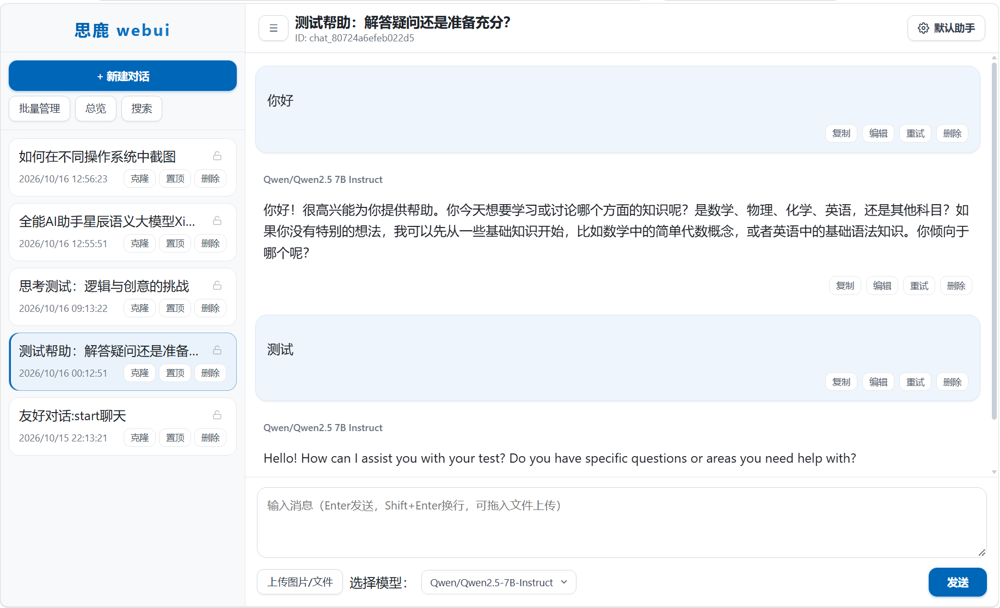

#  DeerThink WebUI PHP 单文件AI

> 一个基于 PHP 单文件实现的轻量级 AI 聊天 WebUI，支持 SSE 流式输出、思考过程可视化、多智能体角色与本地会话管理。

<p align="center">
  
  
  
  
</p>

---

##  特性一览

-  **单文件部署** —— 只需一个 `index.php` 即可运行，无需框架、无需 Composer
-  **SSE 真流式输出** —— 基于 Server-Sent Events 实时推送 token，无缓冲阻塞
-  **思考过程可视化** —— 支持 `reasoning_content` 字段（如 Qwen、DeepSeek-R1 等），思考过程独立折叠展示
-  **多智能体角色** —— 内置法律咨询师、合同审查专家、公文写作助手、翻译专家、编程助手、学习辅导老师等预设，并支持自定义智能体（保存到浏览器）
-  **文件与图片上传** —— 支持拖拽上传，图片自动转 base64 传给多模态模型，文本文件自动提取摘要
-  **会话本地存储** —— 聊天记录保存在浏览器 `localStorage`，不上传服务器，隐私友好
-  **全库搜索 & 总览** —— 支持标题+内容关键词搜索，命中高亮；一键打开当前会话总览
-  **宽屏模式 / 侧栏折叠** —— 桌面端与移动端自适应
-  **Markdown + 数学公式 + Mermaid** —— 支持 KaTeX/MathJax 公式渲染、Mermaid 图表
-  **可中断生成** —— 通过 stop token 机制随时停止服务端生成
-  **消息编辑 / 重试 / 复制 / 删除** —— 完整的消息操作

---

##  界面预览


 


---

##  快速开始

### 环境要求

- PHP >= 7.4（推荐 8.0+）
- 启用扩展：`curl`、`json`、`mbstring`、`fileinfo`
- 可写的目录权限：`uploads/`、`streams/`、`stops/`（程序会自动创建）

### 部署

1. **克隆或下载**

   ```bash
   git clone https://github.com/yourname/deerthink-webui.git
   cd deerthink-webui
